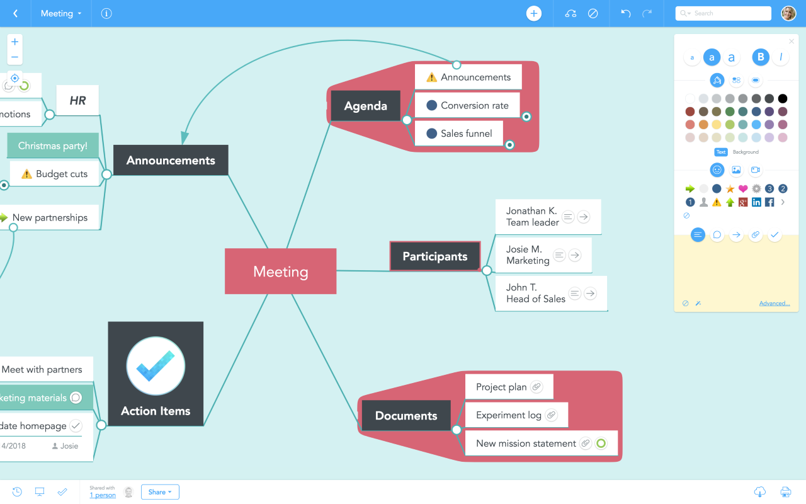
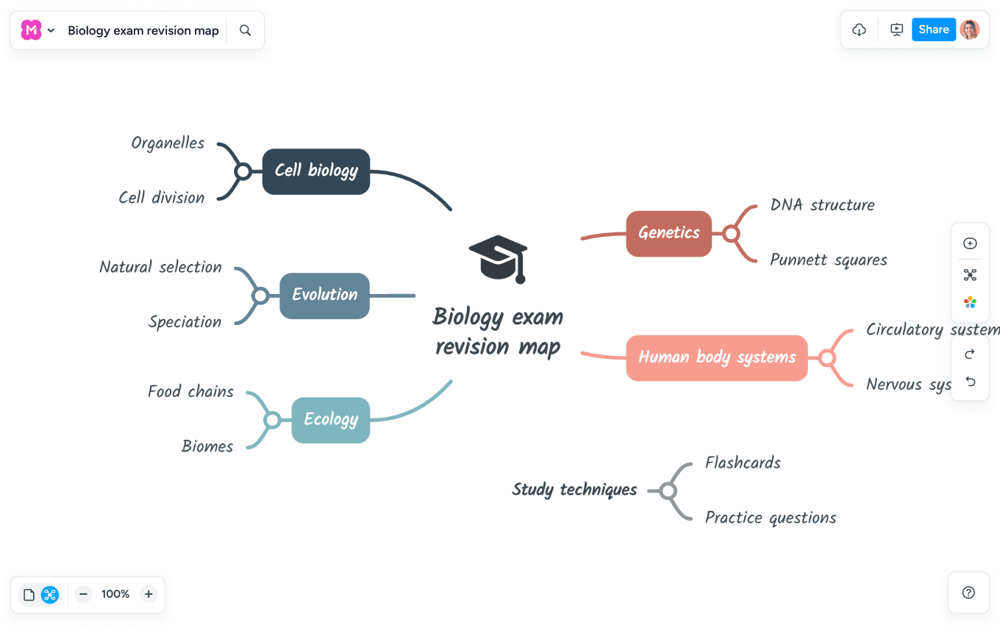

# MindMaster Visual Planning and Mind Mapping Workspace

MindMaster is now known as EdrawMind, Wondershare's application for mind mapping and visual planning.
It helps turn ideas, documents, and discussion notes into structured maps and presentations.

[](https://github.com/wondershare-mindmaster/edraw-mindmaster/releases/)

## Where to Use It

Edraw MindMaster supports individual study, brainstorming, and team planning.
Choose a workflow based on what the map needs to explain.

| Work | Map structure | Useful result |
| --- | --- | --- |
| Research | Main question with evidence branches | A readable overview of findings |
| Meeting preparation | Agenda with decisions and open questions | A focused discussion outline |
| Project planning | Deliverables divided into tasks | A plan that can be reviewed in Gantt view |
| Teaching | Concepts connected to examples | A visual explanation for learners |
| Presentation | Selected branches arranged as slides | A sequence tailored to the audience |

### Keep the Map Focused

Give the central topic a specific purpose.
Use short branch labels and place longer explanations in notes.

Separate supporting evidence from actions that need an owner.
A map can describe a subject without every topic becoming a task.



## Features

Wondershare MindMaster combines visual structure with editing, planning, and presentation tools.
Features and service limits depend on the platform, version, and account plan.

### Organize Information

- Create branches and subtopics around a central idea.
- Change layouts, theme colors, connectors, and topic appearance.
- Add notes, images, tags, and relationships.
- Fold branches to concentrate on a smaller part of the map.
- Work with an outline when a linear view is easier to edit.

### Plan and Explain

Task information connects selected topics with a schedule.
Gantt view displays task dates and durations alongside the map.

Presentation tools provide another way to communicate the same material.
Choose the branches that support the explanation instead of presenting every detail.

## Desktop, Web, and Mobile

Wondershare Edraw MindMaster is available under the current EdrawMind name.
Desktop packages cover Windows, macOS, and Linux; web and mobile editions provide additional access.

### Platform Differences

Use the edition that matches the device and intended workflow.
Do not assume every desktop export or AI feature is available on a phone or in a browser.

The English release history identifies Version 14.0.
The Japanese Windows release history separately lists V14.0.3.

Confirm the edition and language when comparing patch numbers.
A newer regional Windows build does not establish the same version for macOS or Linux.

## Import Structured Content

EdrawMind supports importing Markdown, HTML, Word, and several mind map formats.
Imported formatting and behavior may differ from the source application.

### Markdown Example

Prepare a short hierarchy before importing a larger document.
This example gives a project review three clearly separated branches:

```markdown
# Launch Review
## Outcomes
- Confirm the release scope
## Evidence
- Collect pilot feedback
## Next Actions
- Assign unresolved issues
```

Save the text as a Markdown document and choose Markdown in the import interface.
Review the resulting topics before adding styling or task details.

Headings express the hierarchy, while list items provide supporting points.
Check the imported result when using deeper nesting or rich formatting.

### HTML Example

HTML is another supported input format.
A minimal source can use headings and lists to express the same kind of hierarchy:

```html
<h1>Customer Workshop</h1>
<h2>Questions</h2>
<ul>
  <li>Which workflow causes the most delay?</li>
  <li>What evidence would confirm an improvement?</li>
</ul>
```

Save the snippet as an HTML document before importing it.
Inspect the converted branches rather than expecting a full webpage layout to be preserved.

## Themes, Layouts, and Readability

Mind Master workflows benefit from a consistent visual vocabulary.
Use color for a defined meaning such as ownership, status, or subject area.

### Choose a Layout With a Purpose

A radial map can encourage idea generation around one subject.
A tree or organizational layout can make hierarchy easier to follow.

Keep labels readable at the zoom level used for review.
Large images and long topic names can make a compact map harder to navigate.

### Notes and Relationships

Use notes for explanations that would overwhelm a branch label.
Add relationship lines when a connection crosses the main hierarchy.

Keep the main structure understandable without relying on color alone.
A collaborator should be able to follow the map from its labels and grouping.

## Collaboration and Task Planning

EdrawMind supports simultaneous editing of collaborative maps.
Sharing controls determine whether another person can view or edit the document.

### A Team Review

1. Agree on the purpose of the map.
2. Prepare the main branches before inviting contributors.
3. Choose the appropriate sharing permissions.
4. Collect ideas and clarify duplicate topics.
5. Convert agreed actions into tracked tasks.
6. Review the schedule and remaining questions.

An invitation can be sent to a collaborator's account.
Check permissions before sharing a map that contains internal project information.

### Gantt View

Assign task information to the topics that represent actual work.
Use Gantt view to inspect their timing and duration.

Changes to task information in the Gantt view are reflected in the map.
Review dates and ownership together when the project plan changes.



## Presentation and Export

Choose an output based on what the recipient needs to do.
An image is convenient for viewing, while an editable document supports later revisions.

### Slides and AI Assistance

EdrawMind can generate presentations from text or existing map content.
Its presentation workflow includes editable and non-editable PowerPoint export options.

Review generated wording and slide order before presenting.
Keep the original map so the underlying structure remains available for future revisions.

### Check Exported Files

The following PowerShell example lists files already exported to an existing folder.
It uses a Windows shell command, not an EdrawMind command-line interface:

```powershell
Get-ChildItem -LiteralPath '.\Exports' -File |
    Where-Object { $_.Extension -in '.pdf', '.png', '.pptx' } |
    Select-Object Name, Length, LastWriteTime
```

This lists file names, sizes, and modification times without changing them.
Open important exports to check visual quality and compatibility before distribution.

## Documentation and Licensing

EdrawMind is proprietary software with free and paid offerings.
Review the applicable plan when choosing AI services, collaboration, or export features.

A useful support report includes the platform, application version, source format, and reproduction steps.
For an import problem, prepare a small example that excludes private information.

Use the product guide for edition-specific menu names and supported formats.
Keep a copy of the original document when testing a conversion or a new release.

## Related Search Terms

edraw mindmaster, wondershare mindmaster, wondershare edraw mindmaster, wondershare edraw mind, mind master, mindmap, mind-mapping, mindmapping, brainstorming, knowledge-management, project-management, presentation, productivity, note-taking
